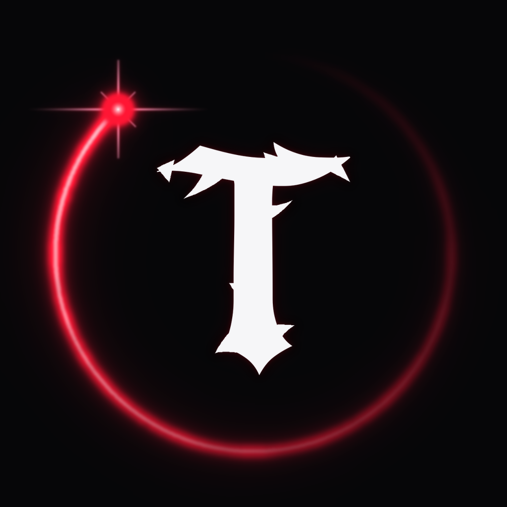

<h1 align="center">Tocles OS</h1>

Linux basado en Arch, en español e inglés, negro y rojo neón. Una sola ISO: se adapta a tu PC.

## ⬇ Descargar

**[⬇ Descargar Tocles OS 1.0](https://github.com/Telmo2012/tocles-os/releases/download/os-v1.0/tocles-os-1.0-x86_64.iso)** (0.56 GB) · [novedades](https://github.com/Telmo2012/tocles-os/releases/tag/os-v1.0)

**Cómo instalarlo:** graba la ISO en un pendrive con [balenaEtcher](https://etcher.balena.io/) o [Ventoy](https://www.ventoy.net/) y arranca el PC desde el pendrive. El instalador:
1. te pregunta el idioma (español o inglés),
2. **revisa tu PC** (procesador, RAM, video, disco, internet) y te hace unas preguntas rápidas,
3. te **recomienda la versión** que mejor le queda (con un semáforo para las demás),
4. y lo instala: en todo el disco, **junto a Windows**, en una partición, o **en el mismo pendrive** (como Puppy).

¿Ya tienes Tocles? No descargues nada: te aparecerá el aviso **«Actualizar ahora»**.

## Las versiones
| | Para |
|---|---|
| **Tocles Mini** | PCs viejos, desde **1 GB de RAM**: todo en C, corre en la RAM, vuela. |
| **Tocles Game** | Jugar: Steam y Proton, juegos de Windows (Wine), emuladores retro, Lutris, Discord y joysticks. |
| **Tocles Full** | Un PC actual: LibreOffice, impresoras, Firefox, GIMP, sonido completo y efectos. |
| **Tocles Code** | Programar y aprender: VS Code, Python, C, Node.js, Java, Git, Podman, Ret Studio y ejemplos. |
| **Tocles Híbrido** | Jugar y estudiar/trabajar en el mismo PC: Game + Full. |

## En todas
- Escritorio propio en C (~65 MB de RAM), con panel rápido (wifi, Bluetooth, volumen, brillo, batería).
- **Zet**: navegador propio, rápido y liviano, con bloqueador de anuncios.
- **Archivos** y **Notas** propios; **Mini Coin**: tienda con semáforo de rendimiento.
- Actualizaciones **firmadas** y automáticas: tus apps se reinstalan solas en su versión nueva.
